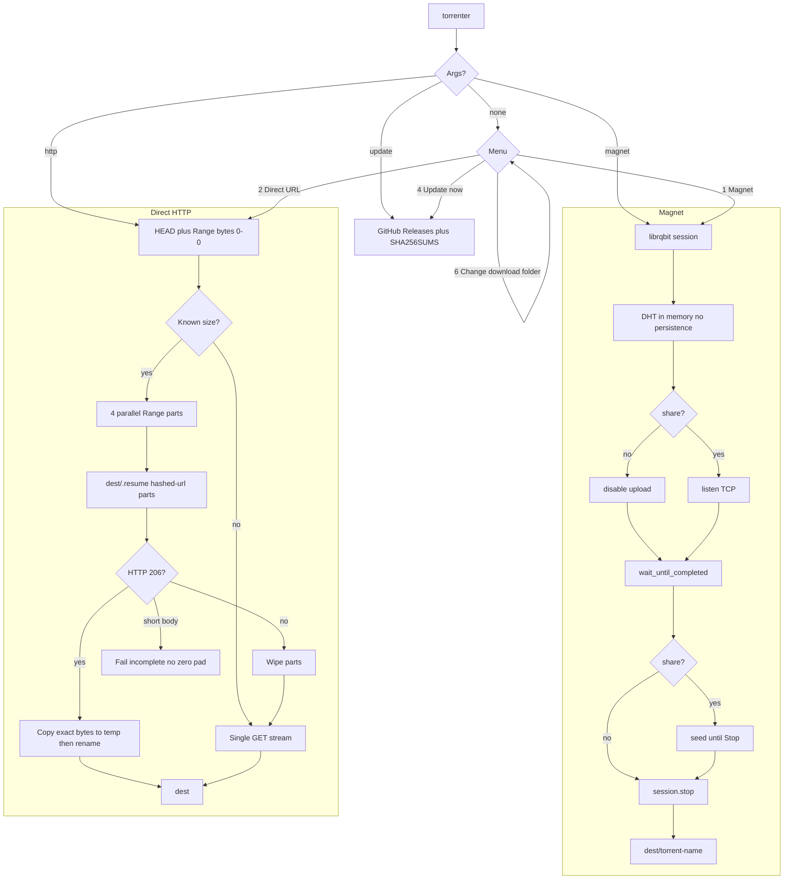

# torrenter

**torrenter gui**


**torrenter cli**


No arguments opens the interactive menu (magnet, HTTP, auto-update, seed, download folder). Subcommands:

```bash
torrenter magnet "magnet:?xt=urn:btih:…"
torrenter http "https://example.com/large-file.iso"
torrenter magnet "magnet:?xt=urn:btih:…" --dir /tmp/out   # one-shot, not saved
torrenter --auto-update          # persist: check GitHub Releases on startup (TTY only)
torrenter --no-auto-update
torrenter update                 # install the latest matching CLI asset now
```

While a download runs, type `1` then Enter to pause/resume, or `2` then Enter to stop.

Downloader with two engines and two fronts. Each [GitHub Release](https://github.com/danted4/torrenter/releases) ships a **CLI** binary and a **native GUI** binary (egui, no HTML/CSS).

1. **Magnet / torrent** — BitTorrent via [librqbit](https://github.com/ikatson/rqbit)
2. **Direct HTTP(S)** — 4-part parallel download with byte-range resume

Output goes to `<OS Downloads>/torrenter` until you pick another folder. Both fronts show `danted4/torrenter vX.Y.Z`. Auto-update is **off** by default.

Pick your OS below. Magnet vs HTTP is in [Two download modes](#two-download-modes).

## Linux

1. Open the [latest GitHub Release](https://github.com/danted4/torrenter/releases/latest).
2. Download the CLI and/or GUI asset:
   - CLI: `torrenter-x86_64-unknown-linux-gnu`
   - GUI: `torrenter-gui-x86_64-unknown-linux-gnu`
3. Make it executable and put it on your `PATH` if you want:

   ```bash
   chmod +x torrenter-x86_64-unknown-linux-gnu torrenter-gui-x86_64-unknown-linux-gnu
   ```

4. **GUI only:** install GTK 3 and xcb at run time. On Debian/Ubuntu:

   ```bash
   sudo apt install libgtk-3-0 libxkbcommon0 libxcb-render0 libxcb-shape0 libxcb-xfixes0
   ```

   The CLI does not need these.

5. Run:

   ```bash
   ./torrenter-x86_64-unknown-linux-gnu
   ./torrenter-gui-x86_64-unknown-linux-gnu
   ```

Linux does **not** show SmartScreen or Gatekeeper. Outbound network is allowed by default on most desktops, so there is usually **no popup**. If a firewall GUI (ufw, firewalld, a VPN client) asks, click **Allow**. Share-mode magnets listen on a random high TCP port; a deny-incoming firewall can block seeding even when downloads still work.

No Rust/Cargo is needed at runtime. Building from source is in the [Development](#development) section.

## Windows

1. Open the [latest GitHub Release](https://github.com/danted4/torrenter/releases/latest).
2. Download the CLI and/or GUI asset:
   - CLI: `torrenter-x86_64-pc-windows-msvc.exe`
   - GUI: `torrenter-gui-x86_64-pc-windows-msvc.exe`
3. Double-click the `.exe` (or run it from PowerShell / Command Prompt).

> [!IMPORTANT]
> 🚨 Windows SmartScreen will often show **Windows protected your PC** because the binary is not a Microsoft-signed installer. If you skip the second click below, the app never starts. The `.exe` did not fail — SmartScreen blocked it.
>
> | ⚠️ | Do this or the app **never starts** |
> |---:|:---|
> | 1️⃣ | Click **More options** |
> | 2️⃣ | Click **Run anyway** |

Releases are **unsigned**. If Explorer still blocks the file, right-click it → **Properties** → check **Unblock** → **OK**, then run it again and use **More options** → **Run anyway** if SmartScreen appears. Microsoft Defender may scan the first run. Pin-to-taskbar uses the icon baked into the `.exe` (v3.2.1+).

> [!NOTE]
> Windows Defender Firewall often asks for network access on **first launch**, the **first share-mode magnet**, and again **after an update** (the new `.exe` looks like a different app).
>
> | ⚠️ | Do this or peers / share mode stay blocked |
> |---:|:---|
> | 1️⃣ | When Windows asks **Allow torrenter to communicate on these networks?** (or similar) |
> | 2️⃣ | Click **Allow** (Private networks is enough for most home PCs) |

Do not click **Cancel** or **Don’t allow** if you want magnet share mode or incoming peers.

## macOS

1. Open the [latest GitHub Release](https://github.com/danted4/torrenter/releases/latest).
2. Download the asset for your Mac (Apple Silicon `aarch64`, Intel `x86_64`):
   - CLI: `torrenter-<arch>-apple-darwin`
   - GUI for Launchpad: `torrenter-gui-<arch>-apple-darwin.app.zip`
   - GUI as a naked Mach-O (optional): `torrenter-gui-<arch>-apple-darwin`

   Releases are **unsigned**. The GUI updater still downloads the naked `torrenter-gui-*` Mach-O (CLI uses `torrenter-*`). The `.app.zip` is extra packaging for Launchpad; it is not the updater asset.

3. **GUI (Launchpad):** download the `.app.zip`, double-click to unzip **`torrenter.app`**, drag it to **Applications**. GitHub sets `com.apple.quarantine`:

   ```bash
   xattr -dr com.apple.quarantine /Applications/torrenter.app
   open /Applications/torrenter.app
   ```

   If macOS still blocks it (“Apple cannot check it for malicious software”): right-click **torrenter** → **Open** → **Open**, or **System Settings → Privacy & Security** → **Open Anyway**. Spotlight and Launchpad list it after it sits in Applications.

4. **CLI / naked GUI:**

   ```bash
   chmod +x torrenter-aarch64-apple-darwin torrenter-gui-aarch64-apple-darwin
   xattr -d com.apple.quarantine torrenter-aarch64-apple-darwin
   xattr -d com.apple.quarantine torrenter-gui-aarch64-apple-darwin
   ./torrenter-aarch64-apple-darwin
   ./torrenter-gui-aarch64-apple-darwin
   ```

> [!NOTE]
> macOS often shows a **network access** popup on **first open** and again **after an update** (a replaced binary is a new app to the OS). Wording varies: *would like to find and connect to devices on the local network*, or *accept incoming network connections*.
>
> | ⚠️ | Do this or magnet / share traffic is blocked |
> |---:|:---|
> | 1️⃣ | When the network popup appears |
> | 2️⃣ | Click **Allow** |

If you clicked Don’t Allow, open **System Settings → Network → Firewall** (or **Privacy & Security → Local Network**) and enable torrenter, then relaunch. Gatekeeper can also return after an update — clear quarantine again if macOS refuses to open the new file.

No Rust/Cargo is needed at runtime. Building from source is in the [Development](#development) section.

## Two download modes

| | **Magnet / torrent** | **Direct HTTP(S)** |
|---|----------------------|---------------------|
| **Use when** | magnet P2P | CDN, mirror, or any direct file URL |
| **Input** | `magnet:?xt=urn:btih:…` | `https://example.com/file.iso` |
| **Engine** | librqbit | `reqwest` + `Range: bytes=` |
| **Parallelism** | piece picker | 4 byte-range parts |
| **Resume** | librqbit on disk under `<dest>/<torrent-name>/` | `<dest>/.resume/` part files |
| **Peers** | live count in the bar | `Peers: 0` |
| **Upload** | **Share** (default): upload while downloading and keep seeding until Stop. **Leech**: never upload; stop at 100% | — |
| **Fallback** | — | single stream if the server ignores ranges |

Magnet links need a 32-character base32 or 40-character hex info hash. `.torrent` files are not accepted. HTTP names come from `Content-Disposition` or the URL path (one path component only; `.` / `..` become `download.bin`).

Single-stream HTTP **does not resume**. It truncates the destination and starts over.

HTTP pause aborts the live Range body and continues from `<dest>/.resume/` on resume. Pause on a single-stream (no Range) download starts that GET over. Stop is honored during HEAD, range probe, part copy, and merge.

Torrent mode uses DHT in memory only. **Share** (default, `seed: on`) uploads while downloading, opens an incoming TCP listen on a random high port, and stays connected after 100% until you press `2` or quit — `torrenter magnet` will not return when the file is complete. **Leech** (`seed: off`) never uploads and calls `session.stop()` at 100%. Each magnet writes into `<dest>/<torrent-name>/` (whitespace becomes `_`). If the magnet has no name, or that folder belongs to a different info-hash, the folder is the hash (or `name_hash`). Overwrite is allowed only inside that folder so a retry can resume. Closing the CLI drops every seed. Closing the GUI drops live sessions too, then restores the job list on the next launch (share rows that were seeding start seeding again if their files are still in that row’s dest).

The GUI uses the same engines: phosphor / amber / ice (last pick saved), magnet/HTTP swap on the URL row, share/leech glyphs, dest path, pause / stop / clear per row. **Stop** immediately shows **clear** (and **restart**). Click a job title to open **that row’s** folder (the dest saved on the job, not the folder used for new START jobs). The copy icon after the title puts that job’s magnet or HTTP URL on the clipboard. Idle rows use **restart** (confirm popup with mode, dest, and share/leech). Search filters jobs (`Esc` clears). At most four downloads run at once; the same magnet or HTTP URL cannot start twice while it is already active. The job list is saved across launches (`jobs.json`). Live rows continue after a dest check (paused rows start paused and still count toward the 4-run cap). A >0% magnet whose files were moved/deleted, or a live HTTP job without `.resume` parts, comes back stopped. Seeding still needs the window open; it resumes on the next launch if that row was left seeding.

## Updates

Opt-in. The updater downloads only `https://github.com/danted4/torrenter/releases/download/<tag>/<name>` (tag in the path must match the release), checks `SHA256SUMS`, caps size, and times out. GitHub then 302s to `objects.githubusercontent.com`; that redirect is followed because the first hop is pinned.

`SHA256SUMS` is **same-publisher integrity**, not a signature. A stolen GitHub token can still ship a binary and a matching sums file.

Startup auto-update is skipped when stdin is not a TTY (scripts, pipes). `torrenter update` always runs when you ask. The GUI binary only replaces itself with `torrenter-gui-*` assets; the CLI binary only replaces itself with `torrenter-*` assets. The binary directory must be writable. Auto and manual install are the same: the new Mach-O overwrites **this** executable (Windows first renames the running file to `*.old`). Startup deletes leftover `*.old`, `.*.update`, and `.*.sha256sums` next to it. If you launched from `torrenter.app`, that bundle stays; only `Contents/MacOS/torrenter-gui` is swapped, then `Info.plist` is restamped and the app is ad-hoc signed again. Other copies (Downloads, an old zip) are not searched or deleted.

## Progress bar

```
[████████████████░░░░] 75% | Peers: 12 | D: 750.45 MB @ 2.5 MB/s | T: 1.0 GB | ETA: 2 minutes
[████████████████████] 100% | Peers: 8 | U: 120.00 MB @ 1.1 MB/s | T: 1.0 GB
```

## How it works



HTTP resume keeps `{sha256(url)[0..16]}.part-N` plus a small JSON manifest under `<dest>/.resume/`. Oversized parts are truncated before append; a short 206 is an error, not a zero-filled hole. Merge writes `.{filename}.merge.tmp` then replaces the final file.

## Configuration

- Download folder: `<OS Downloads>/torrenter` until `download_dir` is set (`src/paths.rs`)
- Parallel HTTP parts: `PART_COUNT = 4` in `src/http.rs`
- GUI concurrent jobs: 4
- Progress format: `BAR_TEMPLATE` in `src/progress.rs`
- HTTP and updater timeouts: 20s connect, 60s between reads
- Auto-update, magnet seed, GUI `theme`, GUI `glass_tint`, and optional `download_dir`: `~/.config/torrenter/config.json` (macOS: `~/Library/Application Support/torrenter/config.json`, Windows: `%APPDATA%\torrenter\config.json`). `seed` defaults to on. `theme` is `phosphor`, `amber`, or `ice` (default phosphor). `glass_tint` is 40–210 (default 60% of that range) and tints the frosted window on macOS/Windows. Missing `download_dir` keeps following the live OS Downloads path. Auto-update stays on the GUI header; theme and tint sit in the cog.
- GUI job list: `jobs.json` in that same folder. Each row keeps its own dest and share/leech. Corrupt files are moved to `jobs.json.bak`.

## Development

Rust 1.85+. No tag is required for doc-only changes on `main`.

```bash
git clone https://github.com/danted4/torrenter.git
cd torrenter
cargo build --release
cargo build --release --features gui --bin torrenter-gui
./target/release/torrenter              # Windows: .\target\release\torrenter.exe
./target/release/torrenter-gui          # Windows: .\target\release\torrenter-gui.exe
```

```bash
cargo test --all-features
cargo fmt --check
cargo clippy --all-targets --all-features -- -D warnings
```

CI on every push and pull request to `main`: fmt, clippy (`-D warnings`), tests on Linux, macOS, and Windows (`--all-features` so the GUI compiles). Linux CI (and local `--all-features` builds) need GTK 3 + xcb **dev** packages: `libgtk-3-dev libxkbcommon-dev libxcb-render0-dev libxcb-shape0-dev libxcb-xfixes0-dev pkg-config`.

Release: `git tag vX.Y.Z && git push origin vX.Y.Z` (commit must already be on `main`). That publishes CLI + GUI binaries, macOS `torrenter-gui-*.app.zip`, and `SHA256SUMS`. Doc-only changes on `main` do not need a tag.

## Troubleshooting

| Problem | Fix |
|---------|-----|
| `Invalid magnet URL` | Must start with `magnet:?xt=urn:` and a 32-char base32 or 40-char hex hash |
| No peers / slow torrent | Wait for DHT; try a seeded magnet; check firewall/UDP |
| Share magnet, no upload | Keep the app open; allow the firewall prompt; leech mode never uploads and does not listen |
| `Too many open files` | torrenter raises the process limit when it can; otherwise `ulimit -n 10240` and retry |
| `Invalid HTTP(S) URL` | Full `http://` or `https://` URL required |
| Multipart not used | Server did not return HTTP 206 — single stream is used instead |
| Resume not working (HTTP) | Same URL and same dest folder; state is in `<dest>/.resume/` |
| Incomplete part | Server closed a Range early; retry the same URL |
| Linux GUI missing GTK/xcb | Install GTK 3 and xcb (see [Linux](#linux)) |
| GUI list empty after restart | Jobs live in `jobs.json` next to `config.json`; a corrupt file is renamed `jobs.json.bak` |
| Saved row says files missing | Payload is gone from **that row’s** dest; Restart starts over there, or Clear drops the row |
| GUI says already downloading | Same magnet info-hash or HTTP URL is already active |
| Auto-update did nothing in a script | Startup check is TTY-only; use `torrenter update` |
| Update hash / URL refused | Asset must be this repo’s release for that tag, with a matching `SHA256SUMS` line |
| Rust version error | Recent stable toolchain if building from source (`rustup update`) |
| Windows: “Windows protected your PC” | Click **More options**, then **Run anyway** (see [Windows](#windows)). Builds are unsigned; this is expected |
| Windows: firewall / network prompt | Click **Allow** (see [Windows](#windows)); repeats after updates |
| macOS: cannot be opened / unidentified developer | `xattr -dr com.apple.quarantine` on `torrenter.app` or the Mach-O, then right-click **Open** or **Privacy & Security → Open Anyway** (see [macOS](#macos)) |
| macOS: local network / incoming connections | Click **Allow** (see [macOS](#macos)); repeats after updates |
| Linux: no permission popup | Normal — Linux usually allows outbound with no prompt (see [Linux](#linux)) |

## Responsible use

Download only **content you have the legal right to access**. Generic tool — not affiliated with rqbit beyond using their OSS library.

## License

[MIT](LICENSE)

## Stargazers over time

[](https://www.star-history.com/#danted4/torrenter&Date)
